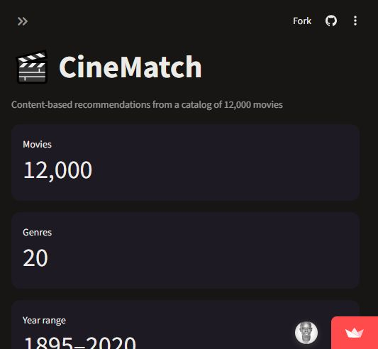
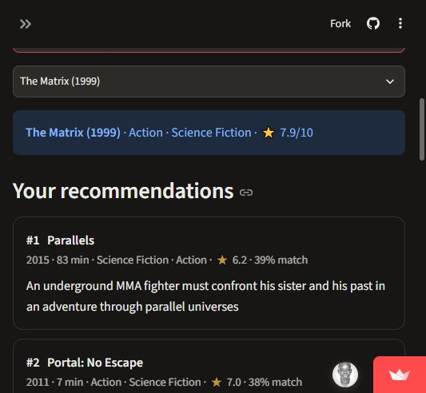
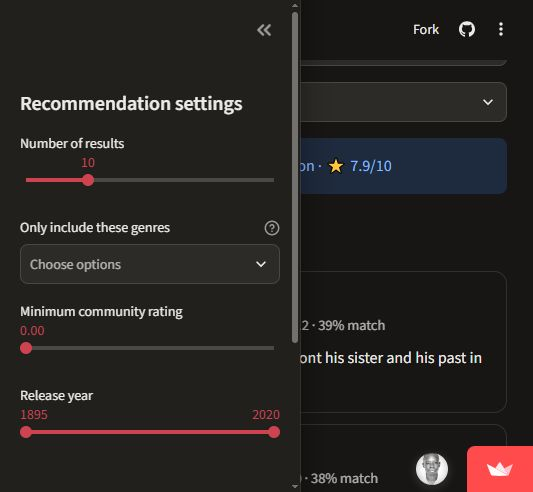

# 🎬 Movie Recommendation System

[](https://github.com/forva2025/Movie_Recommendation_System)
[](https://www.python.org/)
[](https://streamlit.io/)
[](https://scikit-learn.org/)
[](https://pandas.pydata.org/)
[](data/movies.csv)
[](https://movierecommendationsystem-ezhboy6gpd9jelnoqwytp2.streamlit.app/)
[](https://github.com/forva2025/Movie_Recommendation_System/commits)
[](https://github.com/forva2025/Movie_Recommendation_System/issues)
[](LICENSE)

A fast, content-based movie recommendation system with a searchable Streamlit interface and a bundled catalog of **12,000 movies**. Choose a film you enjoy and CineMatch ranks similar titles using genres, plot overviews, and taglines—without needing an account, API key, or internet connection.

## Live demo

The application is deployed on Streamlit Community Cloud:

### [🚀 Launch the Movie Recommendation System](https://movierecommendationsystem-ezhboy6gpd9jelnoqwytp2.streamlit.app/)

## Screenshots

### Catalog dashboard



### Movie recommendations



### Recommendation filters



## Features

- **12,000 real movie records** with title, genres, overview, year, runtime, rating, popularity, language, and TMDB ID
- **Natural-language similarity** using TF-IDF and cosine similarity
- **Search-as-you-type catalog lookup** with release years to distinguish duplicate titles
- **Interactive filters** for genre, minimum rating, release-year range, and result count
- **Transparent match percentages** and movie metadata for every recommendation
- **Movie posters** fetched from TMDB, with a local placeholder when artwork is unavailable
- **Memory-efficient queries** that calculate one similarity vector at a time rather than storing a full 12,000 × 12,000 matrix
- **Reusable Python API** and command-line interface in addition to Streamlit
- **Graceful optional integration**—recommendations need no API key; posters use a TMDB token when configured

## Quick start

### 1. Clone and enter the project

```bash
git clone https://github.com/forva2025/Movie_Recommendation_System.git
cd Movie_Recommendation_System
```

### 2. Create a virtual environment

```bash
python -m venv .venv
```

Activate it on Windows PowerShell:

```powershell
.venv\Scripts\Activate.ps1
```

Or on macOS/Linux:

```bash
source .venv/bin/activate
```

### 3. Install dependencies

```bash
python -m pip install --upgrade pip
pip install -r requirements.txt
```

### 4. Start the web app

```bash
streamlit run app.py
```

Open the local URL printed by Streamlit, usually `http://localhost:8501`.

### 5. Enable movie posters

Recommendations work without external credentials. To display current poster artwork, copy the example secrets file and add a TMDB v4 Read Access Token or v3 API key:

```bash
cp .streamlit/secrets.toml.example .streamlit/secrets.toml
```

On Windows PowerShell:

```powershell
Copy-Item .streamlit/secrets.toml.example .streamlit/secrets.toml
```

Then edit `.streamlit/secrets.toml`:

```toml
TMDB_API_TOKEN = "your-tmdb-read-access-token"
```

For the deployed app, add `TMDB_API_TOKEN` under **Streamlit Community Cloud → App settings → Secrets**. The secret is used only by the server when requesting movie metadata and is never rendered in the browser.

## Using the app

1. Type part of a movie title in the search box.
2. Select the exact movie and year from the matching list.
3. Adjust optional genre, rating, year, and result-count filters in the sidebar.
4. Review the ranked titles, match percentages, genres, ratings, runtimes, and summaries.

If filters are too restrictive, the app displays an empty-state message instead of returning unrelated results.

## Command-line and Python usage

```bash
python recommender.py "The Matrix" -n 10
```

```python
from recommender import MovieRecommender

engine = MovieRecommender()
matches = engine.find_titles("matrix")
movie_id = int(matches.iloc[0]["movie_id"])

recommendations = engine.recommend(
    movie_id,
    n=10,
    genres=["Action", "Science Fiction"],
    min_rating=6.0,
    year_range=(1980, 2026),
)
print(recommendations[["title", "year", "similarity"]])
```

The original helper API remains available as `get_recommendations("The Matrix", n=5)`.

## How it works

```text
movies.csv
   ├── clean text and metadata
   ├── weight genre terms 3×
   └── TF-IDF vectorization (unigrams + bigrams)
                │
selected movie ─┼── cosine similarity against catalog
sidebar filters ─┘
                │
                └── ranked recommendations
```

`TfidfVectorizer` transforms genre, tagline, and overview text into a sparse feature matrix. Genre tokens are repeated three times so genre alignment has more influence than a coincidental shared plot word. For each request, `linear_kernel` computes cosine similarity between one selected row and all catalog rows. The engine then applies metadata filters, excludes the selected movie, and returns the highest scores.

This is a **content-based** system. It does not use individual viewing history or collaborative ratings, so new users can receive results immediately.

## Project structure

```text
Movie_Recommendation_System/
├── app.py                       # Streamlit interface
├── recommender.py               # Search, filtering, and recommendation logic
├── data/
│   └── movies.csv               # Cleaned 12,000-movie catalog
├── scripts/
│   └── prepare_dataset.py       # Reproducible dataset preparation utility
├── requirements.txt             # Runtime dependencies
├── LICENSE                      # MIT license for project code
└── README.md
```

## Dataset

The bundled catalog is a cleaned 12,000-record subset of **The Movies Dataset**, assembled from MovieLens and TMDB metadata and released as CC0. Preparation parses genre objects, normalizes numeric and date fields, removes incomplete and duplicate entries, selects records by vote count, popularity, and rating, and writes only fields needed by the app.

Poster URLs follow TMDB's documented image format and use its `w500` image size. Poster artwork requires an internet connection and a configured `TMDB_API_TOKEN`; recommendations and metadata continue to work from the local catalog. Poster lookups are cached for 24 hours to limit API traffic. This product uses the TMDB API but is not endorsed or certified by TMDB. See [TMDB](https://www.themoviedb.org/) for its data and image terms.

The source dataset is not required to run the app. To rebuild the catalog, download `movies_metadata.csv` from [The Movies Dataset on Kaggle](https://www.kaggle.com/datasets/rounakbanik/the-movies-dataset), rename it to `movies_metadata_source.csv` in the project root, and run:

```bash
python scripts/prepare_dataset.py
```

The large source file is ignored by Git; the cleaned `data/movies.csv` is committed for easy offline setup. Dataset metadata remains subject to its source terms. The repository's Python code is licensed separately under MIT.

## Configuration

Key settings in `recommender.py`:

| Setting | Default | Purpose |
|---|---:|---|
| `ngram_range` | `(1, 2)` | Includes individual words and two-word phrases |
| `min_df` | `2` | Ignores terms occurring in only one movie |
| `max_df` | `0.95` | Ignores terms appearing in nearly every movie |
| `max_features` | `30,000` | Caps vocabulary size and memory use |
| Genre weight | `3×` | Prioritizes genre alignment |

## Troubleshooting

### Movie catalog not found

Make sure `data/movies.csv` exists. If it was removed, rebuild it using the dataset instructions above.

### `streamlit` is not recognized

Activate the virtual environment and run `pip install -r requirements.txt`. Alternatively, launch with `python -m streamlit run app.py`.

### The first page load takes a few seconds

The TF-IDF index is created when the app starts. Streamlit caches it, so later interactions are much faster.

### No recommendations appear

Reset the sidebar filters. A high minimum rating combined with narrow genre and year filters may leave no eligible titles.

## Limitations and roadmap

- Recommendations reflect textual similarity, not personal watch history.
- Ratings may be sparse for obscure films.
- Bundled metadata reflects the source dataset's collection period and is not updated automatically.
- Poster artwork is omitted so the app works completely offline.

Potential improvements include collaborative filtering, user profiles, optional TMDB poster integration, automated tests, and scheduled dataset refreshes.

## Contributing

Issues and pull requests are welcome. Create a focused branch, install the dependencies, locally verify the change, keep generated caches and the full source dataset out of commits, and describe the behavior and verification in the pull request.

## License

The application code is available under the [MIT License](LICENSE). Movie metadata is derived from the CC0 source described in the [Dataset](#dataset) section.
